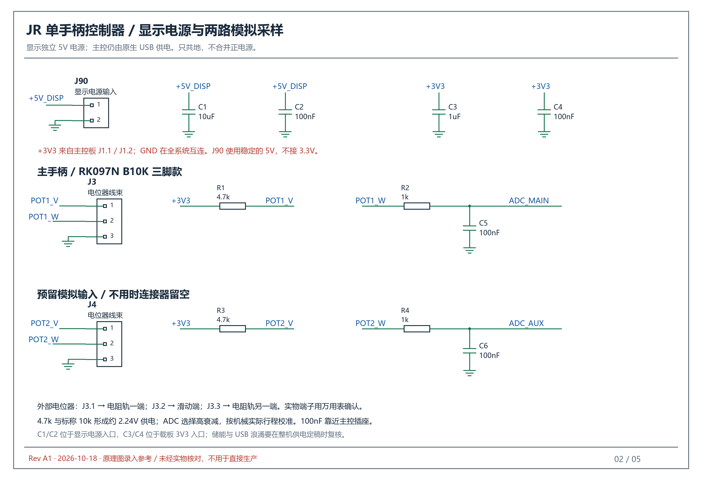

# JR Controller

ESP32-S3 + 电位器的 JR EAST Train Simulator 单手柄控制器项目。

当前版本：**v0.1.0（第一版功能验证）**，详见[版本记录](CHANGELOG.md)。

已在 **中央线 E233 系 0 番台**上验证：Windows 虚拟 XInput 手柄可直接选择 **P1、P3、B5**，无需键盘逐档调整，也不依赖 Steam Input 映射。

**2026-10-21：用户确认主档位与换向验证成功，第一版结束。** 当前遗留问题为机械回差，列入下一阶段处理，详见[第一版验收记录](docs/第一版验收记录.md)。

## 技术路线


当前版本：**GPIO3电位器 + MAX7219点阵（DIN6、CS5、CLK4）**，15点校准已保存；GPIO10按钮选择前进，XInput X轴保持换向、Y轴输出主档位。牵引只显示数字，制动显示数字并点亮最右下角LED，N/EB显示N/E。22项自动测试通过，用户已确认游戏链路验证成功。操作详见[点阵与GPIO3验证](docs/点阵与GPIO3验证.md)。

## 已验证与待完成

| 项目 | 状态 |
| --- | --- |
| ESP32-S3 芯片识别，16MB Flash、芯片报告8MB PSRAM | 已读取，未做存储器压力测试 |
| Windows 虚拟 XInput 轴输出与读回 | 已通过 |
| E233 0 番台 P1/P3/B5 直接命中 | 用户观察游戏 HUD 确认 |
| 所有15档、EB、其他车型 | 未逐项实测 |
| S3固件、ADC校准、串口桥接 | 校准已保存，用户确认主档位正常 |
| GPIO10换向前进 | 改为XInput X轴保持后，用户确认验证成功 |
| MAX7219显示 | 已接入第一版；其他按钮待后续实现 |
| 机械回差 | 用户确认仍存在，下一阶段待解决 |
| PCB封装、原生EDA工程与生产文件 | 未完成；当前图纸为录入参考 |

## 运行测试程序

环境：Windows、Python（本机实测为3.12）、Tkinter、用户安装的 ViGEmBus 驱动。ViGEmBus 已结束维护，使用前请阅读[作者说明](https://docs.nefarius.at/projects/ViGEm/End-of-Life/)。本仓库不打包驱动或第三方库。

安装 Python 依赖（PowerShell）：

```powershell
$env:VGAMEPAD_SKIP_VIGEMBUS_INSTALL = 'true'
python -m pip install -r test_tools/requirements.txt
```

该变量禁止依赖安装流程自动安装驱动。驱动需单独从[作者官方发行页](https://github.com/nefarius/ViGEmBus/releases)获取，并按本机要求完成安装。

测试顺序：

1. 先启动 `test_tools/启动档位测试.cmd`，或运行 `python test_tools/xinput_notch_test.py`。
2. 确认窗口显示虚拟手柄已连接。真实 Xbox 手柄如果占用较低的 XInput 槽，先正常断开它。
3. 保持测试程序开启，**再启动游戏**。游戏初始化时识别 XInput；运行中才创建虚拟手柄，本次测试没有自动切换输入模式。
4. 进入 E233 0 番台驾驶画面。先选择 N，再测试 P1、P3、B1、B5；点击后默认延迟3秒，切回游戏观察 HUD。
5. 结束前输出 N，再关闭测试窗口。

测试程序没有修改游戏文件或内存。`game_input_probe.py` 仅只读检查本次分析版本的进程状态，地址与版本相关，不能当作跨版本的公共 API。

## 绝对档位映射

静态分析发现：游戏存在直接读取 `XInputGetState`、将左摇杆 Y 归一化后转换成牵引/制动目标值的分支。一般档位分支不是“加一档/减一档”，而是写入目标档位。

| 档位 | 左摇杆Y中心值 | 档位 | 左摇杆Y中心值 |
| --- | --- | --- | --- |
| EB | +0.96 | N | 0 |
| B8 | +0.87 | P1 | -0.20 |
| B7 | +0.76 | P2 | -0.40 |
| B6 | +0.655 | P3 | -0.60 |
| B5 | +0.545 | P4 | -0.81 |
| B4 | +0.43 | P5 | -0.96 |
| B3 | +0.32 |  |  |
| B2 | +0.205 |  |  |
| B1 | +0.105 |  |  |

XInput输出为 `round(Y × 32767)`，X轴保持0。表中数值来自该版本内置阈值；当前只有P1/P3/B5由用户确认，其他档位、车型特殊分支和外部配置覆盖都需实测。

详见[技术总结](docs/技术总结.md)。

## 硬件

- 主控：现有ESP32-S3最小系统板。
- 电位器：第一版改用低成本 RK097N B10K 三脚单联线性款（2026-10-18 用户确认），单手柄共用牵引与制动。原 ALPS RK09L1120A5F 保留为备选，端子、封装与轴连接件不能直接互换。
- 载板参考图主ADC：GPIO1；按现有图纸经4.7kΩ供电限幅、1kΩ串联和100nF滤波。当前临时实测改用GPIO3，电位器两侧接3V3/GND。
- USB：保留GPIO19/20及板上原生接口。
- 12路按钮：GPIO4–15；换向触点GPIO16/17；独立EB触点GPIO18；校准GPIO21。
- 显示：MAX7219单色8×8，经SN74AHCT125转换3.3V信号到5V。

具体板卡排针、供电路径与机械尺寸仍需实物核对。A0图纸采用主控USB供电、显示独立5V、仅共地的安排。



## 目录

| 路径 | 内容 |
| --- | --- |
| `docs/技术总结.md` | 接口分析结论、验证过程、限制和实现计划 |
| `docs/点阵与GPIO3验证.md` | 当前接线、数字与制动角灯、重新校准步骤 |
| `docs/第一版验证.md` | 历史GPIO5/OLED接线 |
| `firmware/` | ESP32-S3 ADC3 + MAX7219固件，保留独立点阵测试与旧OLED环境 |
| `test_tools/` | 手动XInput档位测试、只读诊断、依赖说明 |
| `hardware/schematic_images/` | 5页PNG/SVG原理图参考、BOM和逐引脚表 |
| `hardware/draw_schematic.py` | 图纸生成脚本，使用Pillow与Windows微软雅黑字体 |
| 根目录SolidWorks/STL文件 | 现有机械模型，未宣称已完成尺寸/装配验证 |

游戏文件、提取数据、本机运行日志、第三方依赖与私人附件不包含在仓库中。
